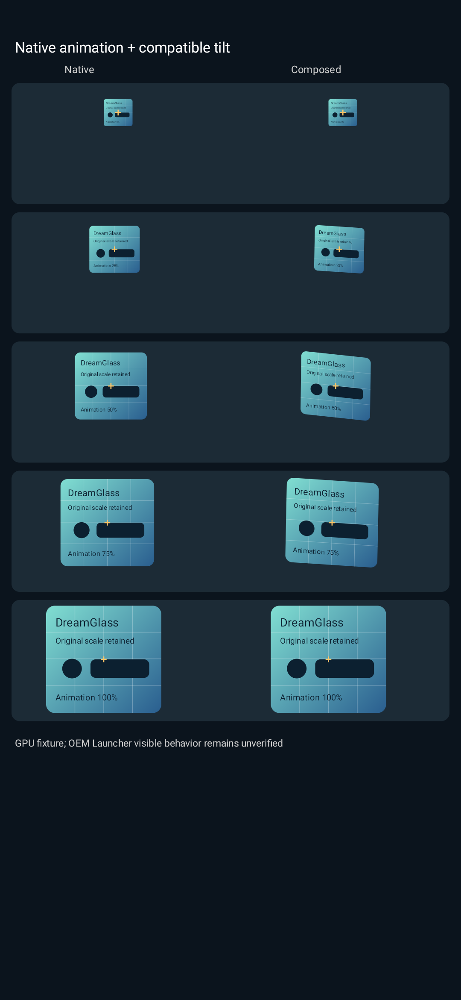

# 窗口倾斜兼容候选

1.1.7 的应急停用保留在正式版本；1.1.8-debug 候选继续尝试修复倾斜本身，没有重新启用此前的独立 4×4 注入。

新路径只在已验证的标准／轻动画单目标回调内，替换原生 `xi.q$b.i(Matrix)` 的参数副本。矩阵为“当前原生仿射 × 围绕源中心的倾转”，保留当前帧的缩放因素与中心运动路径，原始共享 Matrix 不被修改。动画开头、结尾、关闭开关、无效输入与未匹配目标直接放行原参数。原生方法只执行一次，异常不重放。

它使用三维旋转的平行投影，提供前后压缩、对角倾转与侧向摆动，**没有完整近大远小透视**。设置页明确标注兼容模式，并将旧透视参数解释为侧向倾转。新安装默认关闭，已有明确保存的开关配置保留。通知卡片倾斜保持独立。

没有 SurfaceControl 全局事务 Hook、4×4 通道、独立事务、定时单位矩阵复位、保留的窗口 leash 或额外动画时钟；不修改系统动画倍率。当前候选实际在手机上加载了两条安装路径，但尚未观测到兼容矩阵写入，也未完成可见倾斜验收，不能宣称真机已经修复。

14 项新增测试覆盖原生缩放因素、逐帧中心路径、多种宽高比、端点精确恢复、最大角度不翻转／不坍缩、原始矩阵不变、目标／线程／嵌套作用域隔离和宿主异常只执行一次。总计 168 项测试通过。合成 GPU 对照证明同一组矩阵具有可见倾转并保留端点，不能替代 OEM 动画验收。

