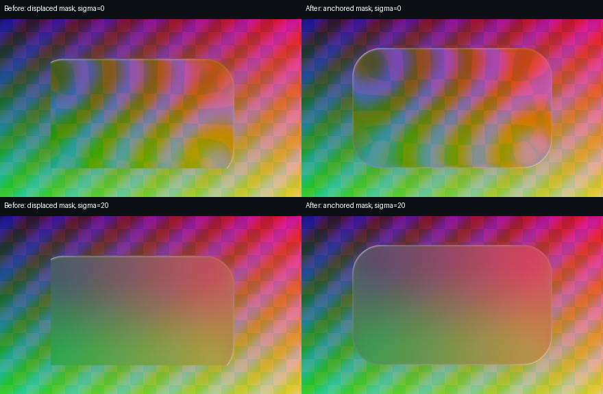

# 1.1.9-debug2 本地验证

不连接 ADB，无安装、重启或设备操作。构建、JVM 回归、Lint、签名及 DEX 审计见 audit.json。

## 离线渲染

[report.json](report.json) 来自实际共享 AGSL，背景为脚本生成，Skia 144.1 桌面 F32 软件栅格。上方无模糊、下方独立预模糊；左为带 parallax 的旧固定宿主适配，右为锚定蒙版。共用 shader 及控制中心行为未修改。

可复现：`python scripts/validate_native_surface_optics.py --output <directory> [--module-dir <python-module-directory>]`，需要 skia-python、numpy、Pillow。安装它们仅供离线验证，APK 不引入这些依赖。

原生背景轮廓平移的 alpha 最大误差约 5.96e-8，源坐标最大误差约 1.79e-7。预模糊不改变参考蒙版覆盖；parallax 会移动蒙版，固定轮廓裁剪产生矩形切口。适配归零后恢复完整轮廓。完整数值见 report.json。

Python 绑定缺少 RuntimeShader ImageFilter，此测试先将高斯模糊栅格化，再由 shader 采样，不能验证 Android RenderEffect 链的滤镜外扩／原点、OEM 背景输入、厂商控件或 GPU。

## 静态实现核对

- Gallery 17.10.41：COUIButton 转发 setter、COUIStateEffectDrawable 图层索引、原生导航绘制矩形、COUIBottomFloatingToolbarMenuView、PhotoMenuMaterialEffectController 使用的 n0q 工厂。
- Shelf 17.14.60：search_bar／ai_icon／add_icon 及各自 *_blur 同父 View。
- Launcher 样本：小布建议背景与包装身份、82/83 卡片类型、createBlurBackground 双参数顺序；堆叠 delegate 的 createAllTasksDismissAnimation 调用 k.c 前排除锁定／快速启动。

仅分发独立实现及检查结论；不包含系统 APK、反编译源代码或个人截图。没有相册此次闪退的设备异常栈，因此只确认危险路径被修正，不能排除其他设备原因。

## 后续设备验收

重新确认当前版本并启用所需开关、手动重载作用域后，测试相册编辑保存弹窗、选择保存副本、主页底栏、单图工具条、负一屏顶部、小布建议及多任务清空。验证锁定卡片保留、取消不飘散、关闭效果能恢复原生、无新崩溃。此清单本轮未执行。
